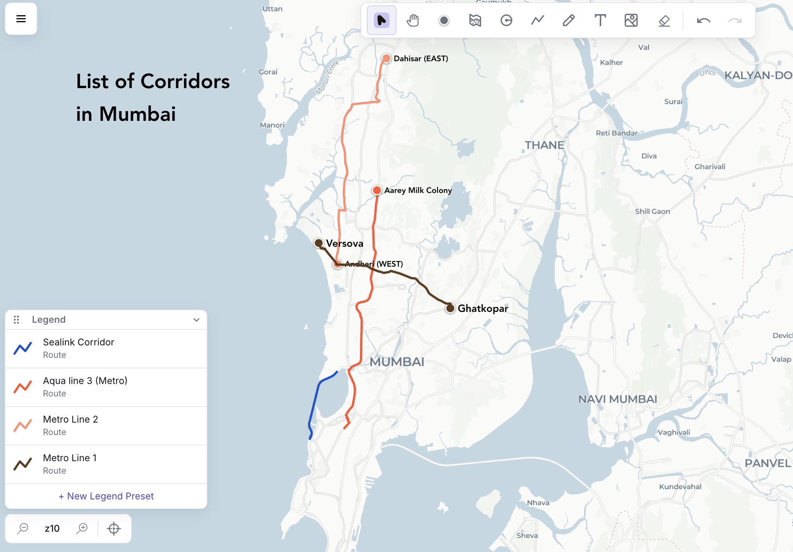

<p align="center">
    
</p>

<p align="center">
    <strong>A whiteboard that knows where things are.</strong><br />
    Sketch routes, areas and notes on a real map, right in the browser.
</p>

<p align="center">
    <a href="https://mapcursor.com">mapcursor.com</a> ·
    <a href="https://mapcursor.com/use-cases">Use cases</a> ·
    <a href="https://github.com/meetzaveri/mapcursor/issues">Issues</a>
</p>



## Why this exists

Mapcursor is a side project. I have a full-time job doing something else, and
before this I built [Craftbase](https://github.com/meetzaveri/craftbase), an
infinite whiteboard for sketching and diagramming.

While working on Craftbase I got curious: what if the same engine that draws
shapes on a whiteboard drew them on a map instead? The canvas, the drawing
tools and the scene graph could all stay. Only the surface underneath would
change, from a blank page to the real world.

That idea became Mapcursor. It's for the moments when full GIS is too much:
you want to point at a place, trace a route, shade an area and send it to
someone. You don't need an account, a project or a toolbar tutorial for that.

## What you can do

| Tool   | What it's for                                         |
| ------ | ----------------------------------------------------- |
| Point  | Drop a named pin                                      |
| Route  | Trace a line, optionally snapped to the road network  |
| Area   | Shade a neighbourhood, a zone or a site               |
| Radius | A circle that keeps its real-world radius as you zoom |
| Pencil | Freehand sketching over the map                       |
| Text   | Labels that stay readable at any zoom                 |
| Image  | Pin a photo where it was taken                        |

Around those tools:

- **Legend presets.** Define "Metro line" or "No vehicle lane" once, apply it
  to any feature, and the legend explains your map for you. Restyle the preset
  and every feature using it updates.
- **Custom properties** on any feature, defined once per map.
- **Export** the view as PNG (basemap included), a selection as SVG, or the
  whole map as JSON you can import later.
- **Share** a link when you're ready. Until then, everything stays in your
  browser.

Some worked examples:
[transit corridors in Mumbai](https://mapcursor.com/use-cases/city-corridors)
and [a road trip with photos](https://mapcursor.com/use-cases/road-trip).

### What it isn't

Mapcursor is not an analysis tool. There's no geoprocessing, no projection to
choose (it's Web Mercator) and no shapefile or GeoJSON import yet. If you
need those, QGIS is what you want. Mapcursor is for the step before or after
it: the quick sketch, the slide, the "here's what I mean" message.

## Running it locally

You'll need a current Node LTS and Yarn 1.

```bash
git clone https://github.com/meetzaveri/mapcursor.git
cd mapcursor
yarn
cp .envexample .env
yarn start            # http://localhost:5173
```

Drawing, local saving and export work without a backend. Share links and saved
maps need the GraphQL backend (Hasura + Postgres) from
[mapcursor-hasura](https://github.com/meetzaveri/mapcursor-hasura); follow its
README, then point `VITE_GRAPHQL_ENDPOINT` and `VITE_WS_GRAPHQL_ENDPOINT` at it.

| Command          | Does                                 |
| ---------------- | ------------------------------------ |
| `yarn build`     | Production build into `dist/`        |
| `yarn preview`   | Serve the production build           |
| `yarn typecheck` | `tsc --noEmit`                       |
| `yarn test`      | Unit tests (Vitest)                  |
| `yarn test:e2e`  | End-to-end tests (Playwright)        |
| `yarn codegen`   | Regenerate GraphQL types from Hasura |

### Finding your way around

```
src/
    views/Base/        the workspace page and BaseContext
    newCanvas.tsx      the canvas: two.js setup and every input handler
    components/
        elements/      one component per drawable (point, route, area, ...)
        sidebar/       toolbars and the properties panel
        legend/        legend presets
    factory/           templates for each element type
    baseTypes/         the MapLibre backdrop and map anchoring
    utils/             geometry, export/import, road snapping, ...
```

Stack: React 18, TypeScript, Vite, two.js, MapLibre GL, Apollo + Hasura,
Tailwind.

## Status

Built on evenings and weekends, so it moves in bursts. Expect rough edges.
Bug reports, ideas and "I tried to do X and couldn't" are all useful.
[Open an issue](https://github.com/meetzaveri/mapcursor/issues); I read every
one, even if a reply takes a few days.

Pull requests are welcome too. For anything bigger than a bug fix, open an
issue first so we can talk it through before you spend your weekend on it.

## License

[MIT](./LICENSE)
